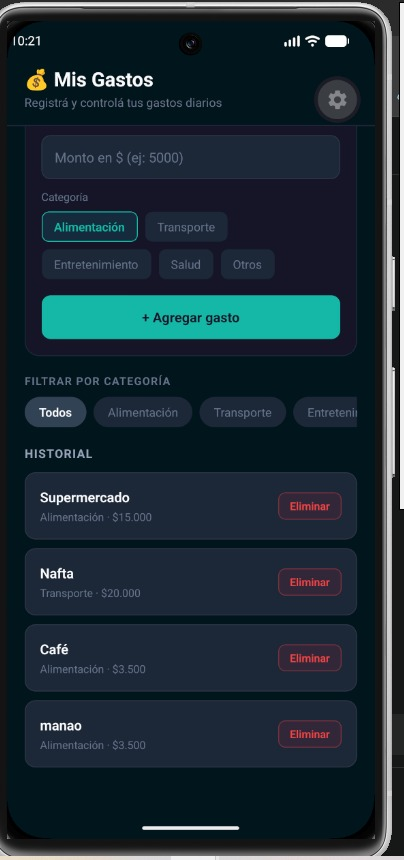

# 💰 Gestor de Gastos Personales

Aplicación móvil desarrollada con **React Native + Expo** para registrar y controlar gastos personales.

---

## 📱 Capturas de pantalla

<p align="center">
  
  &nbsp;&nbsp;&nbsp;
  
</p>

---

## 🚀 Cómo correr el proyecto

**1. Clonar el repositorio**
```bash
git clone https://github.com/igleciaprecente-arch/tp_Movil.git
cd tp_Movil
```

**2. Instalar dependencias**
```bash
npm install
```

**3. Iniciar la app**
```bash
npm start
```
Escaneá el QR con la app **Expo Go** desde tu celular.

---

## 📁 Estructura del proyecto

```
gestordegastos/
├── App.js
├── package.json
├── app.json
├── babel.config.js
└── src/
    ├── constantes/
    │   └── categorias.js
    ├── styles/
    │   └── colors.js
    └── components/
        ├── Header.js
        ├── Dashboard.js
        ├── FormularioGasto.js
        ├── FiltrosCategorias.js
        ├── ListaGastos.js
        └── ItemGasto.js
```

---

## ⚙️ Tecnologías

- React Native
- Expo SDK 58
- JavaScript
